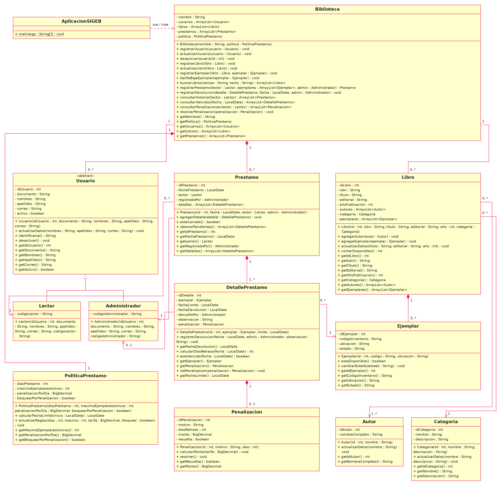

# SIGEB — Sistema de Gestión de Biblioteca

Proyecto académico que busca automatizar los procesos de una biblioteca: registro de usuarios y libros, búsqueda, préstamos y devoluciones, para mejorar la atención y la administración del catálogo.

## Sprint 2

En este sprint se implementó la interfaz gráfica con Java Swing y se integraron las clases desarrolladas durante el primer sprint.

Se incorporaron `Biblioteca`, `AplicacionSIGEB` y las ventanas para gestionar usuarios, catálogo, préstamos, devoluciones, penalizaciones y política de préstamos. Los módulos comparten una misma instancia de `Biblioteca` y utilizan `ActionListener` para responder a los botones.

El proyecto utiliza Java y almacena los datos en memoria durante la ejecución. **Al cerrar la aplicación, los registros se pierden.** El guardado y la lectura de archivos se desarrollarán en el siguiente sprint.

## Requisitos

- JDK 17 o superior.
- Un entorno con escritorio gráfico para mostrar las ventanas Swing.
- Una terminal o un editor compatible con Java.
- Si se utiliza Visual Studio Code: Extension Pack for Java.

No se requieren bibliotecas externas.

## Estructura del proyecto

| Ubicación | Contenido |
|---|---|
| `src/` | Clases del modelo, Biblioteca, AplicacionSIGEB y ventanas GUI. |
| `SIGEB_UML.png` | Diagrama de clases actualizado. |
| `README.md` | Descripción e instrucciones. |
| `out/` | Archivos compilados; se genera al compilar. |

## Cómo ejecutar

### 1. Abrir el proyecto

Descarga y descomprime el proyecto o clona el repositorio.

Abre una terminal dentro de la carpeta `sigeb`, donde se encuentran `src` y `README.md`.

### 2. Comprobar Java

Ejecuta:

```bash
java -version
javac -version
```

Ambos comandos deben mostrar la versión instalada. Si `javac` no está disponible, comprueba que tengas instalado un JDK completo y configurado en PATH.

### 3. Compilar

Desde la raíz del proyecto:

```bash
javac -encoding UTF-8 -d out src/*.java
```

Este comando compila las clases de `src` y guarda los archivos `.class` en `out`. La carpeta `out` se crea automáticamente.

Si no aparecen errores, la compilación finalizó correctamente.

### 4. Ejecutar la aplicación

```bash
java -cp out AplicacionSIGEB
```

Se abrirá la ventana principal de SIGEB, con acceso a **Usuarios**, **Catálogo e inventario** y **Préstamos y devoluciones**.

Cada vez que se modifique el código, se debe volver a compilar antes de ejecutar.

## Ejecutar en Visual Studio Code

1. Abre la carpeta `sigeb` con **Archivo > Abrir carpeta**.
2. Comprueba que tengas instalado el JDK y Extension Pack for Java.
3. Abre `src/AplicacionSIGEB.java`.
4. Pulsa **Run Java** sobre el método `main`.
5. Utiliza los botones de la ventana principal para acceder a los módulos.

También puedes compilar y ejecutar con los comandos anteriores desde la terminal integrada.

## Cómo usar la aplicación

### 1. Usuarios

1. Pulsa **Usuarios** en la ventana principal.
2. Selecciona el tipo: lector o administrador.
3. Completa ID, documento, nombres, apellidos, correo y código.
4. Pulsa **Registrar** para guardar el usuario en memoria.
5. Usa **Listar** para actualizar el listado.

Para actualizar un usuario, escribe su ID y los nuevos nombres, apellidos y correo; después pulsa **Actualizar**. Para desactivarlo, escribe su ID y pulsa **Desactivar**.

Antes de realizar un préstamo deben existir un lector activo y un administrador activo.

### 2. Catálogo e inventario

1. Abre **Catálogo e inventario**.
2. En la sección **Categorías**, registra una categoría.
3. En **Autores**, registra el autor.
4. En **Libros**, registra el libro con su categoría y asigna el autor.
5. En **Ejemplares**, agrega una copia indicando ID, código de inventario y ubicación.

El módulo también permite actualizar datos, buscar libros por título o ISBN y consultar el estado de los ejemplares. Una copia con préstamo pendiente debe devolverse antes de cambiar su estado manualmente.

### 3. Registrar un préstamo

1. Abre **Préstamos y devoluciones** y selecciona **Registrar préstamo**.
2. Selecciona el lector y el administrador.
3. Selecciona un ejemplar disponible y pulsa **Agregar ejemplar**.
4. Repite la selección si deseas prestar más ejemplares.
5. Pulsa **Registrar**.

La fecha del préstamo será la actual y el límite se calculará con la política vigente. El sistema comprueba disponibilidad, ejemplares repetidos, máximo de préstamos activos y bloqueo por penalizaciones pendientes.

### 4. Registrar una devolución

1. Selecciona **Registrar devolución**.
2. Elige el ejemplar pendiente y el administrador.
3. Introduce la fecha en formato `AAAA-MM-DD`.
4. Pulsa **Registrar devolución**.

La fecha no puede ser anterior al préstamo ni posterior al día actual. La devolución vuelve a poner el ejemplar disponible y, si existe retraso, genera una penalización. El préstamo se cierra cuando todos sus ejemplares fueron devueltos.

### 5. Consultas y penalizaciones

- En **Consultar préstamos**, selecciona historial, pendientes o vencidos y pulsa **Actualizar** para refrescar la información.
- En **Penalizaciones**, selecciona una penalización y pulsa **Resolver** para marcarla como resuelta.
- El monto se calcula multiplicando los días de retraso por la tarifa vigente al registrar la devolución.

### 6. Política de préstamos

1. Abre **Política de préstamos**.
2. Configura los días, el máximo de ejemplares y la tarifa diaria.
3. Indica si se bloquearán nuevos préstamos por penalizaciones pendientes.
4. Pulsa **Guardar**.

Los días y el máximo deben ser positivos; la tarifa no puede ser negativa. Usa punto decimal, por ejemplo: `1.50`.

## Ejemplo de uso completo

1. Registrar un lector y un administrador.
2. Registrar una categoría y un autor.
3. Registrar un libro y asignarle el autor.
4. Agregar un ejemplar disponible.
5. Registrar un préstamo para el lector.
6. Consultar el préstamo pendiente.
7. Registrar la devolución.
8. Comprobar que el ejemplar vuelve a estar disponible.

Los formularios cargan sus selectores al abrirse. Si registras datos nuevos desde otra ventana, cierra y vuelve a abrir el formulario para actualizar las opciones. Los mensajes de validación de Biblioteca también pueden aparecer en la consola.

## Solución de problemas

| Problema | Solución |
|---|---|
| No se reconoce `javac` | Instalar un JDK y configurar su carpeta `bin` en PATH. |
| No se encuentra `src/*.java` | Ubicar la terminal en la raíz del proyecto, donde está `src`. |
| No se encuentra `AplicacionSIGEB` | Compilar y ejecutar con `java -cp out AplicacionSIGEB`. |
| Se indica que falta el método `main` | Ejecutar `AplicacionSIGEB`, que inicia la aplicación. |
| No aparecen lectores o administradores | Registrar usuarios activos y volver a abrir el formulario de préstamos. |
| No aparecen ejemplares disponibles | Registrar libros y ejemplares antes de abrir el formulario. |
| Los cambios no aparecen en una consulta | Pulsar **Actualizar** o volver a abrir la ventana. |
| Los datos desaparecen al cerrar | En este sprint los datos solo se almacenan en memoria. |

## Próximo sprint

El Sprint 3 se centrará en la entrada y salida de archivos para conservar la información entre ejecuciones.

- Guardar y recuperar usuarios y política de préstamos.
- Guardar y recuperar autores, categorías, libros y ejemplares.
- Guardar y recuperar préstamos, devoluciones y penalizaciones.
- Mantener las relaciones entre registros mediante sus IDs.
- Evitar duplicados durante la carga.
- Manejar archivos inexistentes y errores de lectura o escritura.
- Verificar que los datos se mantengan al cerrar y abrir la aplicación.

Se propone comenzar con archivos de texto utilizando `PrintWriter`, `FileWriter`, `Scanner` y `FileReader`, de acuerdo con lo trabajado en clase.

## Diagrama UML


