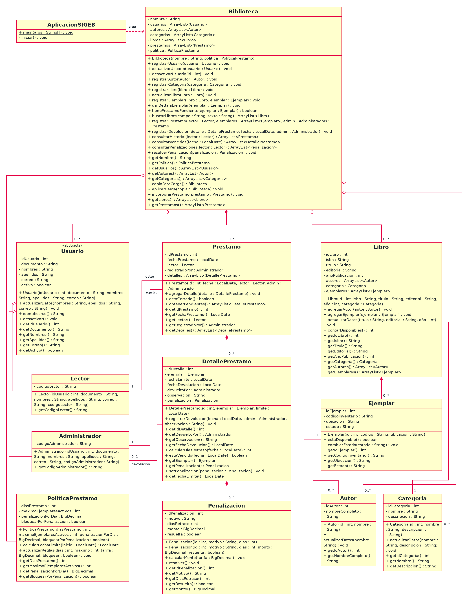

# SIGEB — Sistema de Gestión de Biblioteca

Proyecto académico que busca automatizar los procesos de una biblioteca: registro de usuarios y libros, búsqueda, préstamos y devoluciones, para mejorar la atención y la administración del catálogo.

## Sprint 2

En este sprint se implementó la interfaz gráfica con Java Swing y se integraron las clases desarrolladas durante el primer sprint.

Se incorporaron `Biblioteca`, `AplicacionSIGEB` y las ventanas para gestionar usuarios, catálogo, préstamos, devoluciones, penalizaciones y política de préstamos. Los módulos comparten una misma instancia de `Biblioteca` y utilizan `ActionListener` para responder a los botones.

## Sprint 3 — Persistencia en archivos de texto

SIGEB carga al inicio los usuarios, la política de préstamos, el catálogo y el historial de préstamos. El botón **Guardar datos** de la ventana principal guarda las modificaciones de todos los módulos. La opción **Guardar** del formulario de política aplica las reglas a la sesión. Después, **Guardar datos** las escribe en disco.

Ejecuta SIGEB desde la raíz del proyecto para guardar y cargar los nueve archivos en el mismo lugar. En la primera ejecución los registros empiezan vacíos y se aplica la política de 7 días, 3 ejemplares activos, 1.50 de tarifa diaria y bloqueo por penalización pendiente. SIGEB también puede abrir los archivos `usuarios.txt` y `politica.txt` generados por la entrega anterior.

### Formato de los archivos

| Archivo | Campos en orden |
|---|---|
| `usuarios.txt` | Tipo, ID, documento, nombres, apellidos, correo, activo, código |
| `politica.txt` | Días de préstamo, máximo de ejemplares activos, tarifa diaria, bloqueo por penalización |
| `autores.txt` | ID de autor, nombre completo |
| `categorias.txt` | ID de categoría, nombre, descripción |
| `libros.txt` | ID de libro, ISBN, título, editorial, año, ID de categoría, IDs de autores |
| `ejemplares.txt` | ID de ejemplar, ID de libro, código de inventario, ubicación, estado |
| `prestamos.txt` | ID de préstamo, fecha del préstamo, ID de lector, ID del administrador que lo registró |
| `detalles.txt` | ID de detalle, ID de préstamo, ID de ejemplar, fecha límite, fecha de devolución, ID del administrador de devolución, observación |
| `penalizaciones.txt` | ID de penalización, ID de detalle, motivo, días de retraso, monto, resuelta |

Cada registro ocupa una línea en UTF-8 y usa `|` como separador. Los IDs de autores de un libro se separan con comas y ese campo puede quedar vacío. En los detalles pendientes quedan vacíos los tres campos de devolución. Las fechas usan `AAAA-MM-DD` y los booleanos son `true` o `false`. En los campos de texto se codifican el separador, el signo `%` y los saltos de línea.

`PersistenciaSIGEB` coordina la carga de usuarios y política, luego llama a `PersistenciaCatalogo` y finalmente a `PersistenciaPrestamos`. Este orden permite reconstruir las relaciones por ID con los objetos registrados en `Biblioteca`. Los archivos se validan antes de aplicar la carga. Si hay un ID duplicado, una referencia inexistente o un formato incorrecto, la aplicación muestra un error.

La implementación sigue el capítulo 7 de los PDF **Tema07 Archivos2026 1** y **Tema07 Archivos2026 2**. Usa `FileWriter` y `PrintWriter.println()` para escribir, y `FileReader` y `Scanner.nextLine()` para leer los registros secuencialmente.

## Requisitos

- JDK 17 o superior.
- Un entorno con escritorio gráfico para mostrar las ventanas Swing.
- Una terminal o un editor compatible con Java.
- Si se utiliza Visual Studio Code: Extension Pack for Java.

No se requieren bibliotecas externas.

## Estructura del proyecto

| Ubicación | Contenido |
|---|---|
| `src/` | Clases del modelo, Biblioteca, AplicacionSIGEB y ventanas GUI. |
| `SIGEB_UML.png` | Diagrama de clases actualizado. |
| `README.md` | Descripción e instrucciones. |
| Archivos `.txt` | Los nueve archivos de datos se generan al pulsar **Guardar datos**. |
| `out/` | Archivos compilados; se genera al compilar. |

## Cómo ejecutar

Abre una terminal en la carpeta `sigeb`, donde están `src/` y `README.md`. Comprueba que tienes JDK 17 o superior y acceso a una sesión gráfica para abrir Swing.

```text
java -version
javac -version
```

### Linux, macOS o Git Bash

```bash
javac -encoding UTF-8 -d out src/*.java
java -cp out AplicacionSIGEB
```

### Windows PowerShell

```powershell
$fuentes = (Get-ChildItem -Path src -Filter *.java).FullName
javac -encoding UTF-8 -d out $fuentes
java -cp out AplicacionSIGEB
```

Compila con `-encoding UTF-8` para que Java lea correctamente nombres como `añoPublicacion` y `getAñoPublicacion()`. La carpeta `out/` se crea al compilar. Repite la compilación después de modificar el código.

### Visual Studio Code

Abre la carpeta completa `sigeb` e instala **Extension Pack for Java**. En `src/AplicacionSIGEB.java`, pulsa **Run Java** sobre `main`. También puedes usar los comandos anteriores desde la terminal integrada, abierta en la raíz de `sigeb`.

## Cómo usar la aplicación

### 1. Usuarios

1. Pulsa **Usuarios** en la ventana principal.
2. Selecciona el tipo: lector o administrador.
3. Completa ID, documento, nombres, apellidos, correo y código.
4. Pulsa **Registrar** para agregar el usuario a la sesión. Usa **Guardar datos** en la ventana principal para conservarlo al cerrar.
5. Usa **Listar** para actualizar el listado.

Para actualizar un usuario, escribe su ID y los nuevos nombres, apellidos y correo; después pulsa **Actualizar**. Para desactivarlo, escribe su ID y pulsa **Desactivar**.

Antes de realizar un préstamo deben existir un lector activo y un administrador activo.

### 2. Catálogo e inventario

1. Abre **Catálogo e inventario**.
2. En la sección **Categorías**, registra una categoría.
3. En **Autores**, registra el autor.
4. En **Libros**, registra el libro con su categoría y asigna el autor.
5. En **Ejemplares**, agrega una copia indicando ID, código de inventario y ubicación.

El módulo también permite actualizar datos, buscar libros por título o ISBN y consultar el estado de los ejemplares. Una copia con préstamo pendiente debe devolverse antes de cambiar su estado manualmente.

### 3. Registrar un préstamo

1. Abre **Préstamos y devoluciones** y selecciona **Registrar préstamo**.
2. Selecciona el lector y el administrador.
3. Selecciona un ejemplar disponible y pulsa **Agregar ejemplar**.
4. Repite la selección si deseas prestar más ejemplares.
5. Pulsa **Registrar**.

La fecha del préstamo será la actual y el límite se calculará con la política vigente. El sistema comprueba disponibilidad, ejemplares repetidos, máximo de préstamos activos y bloqueo por penalizaciones pendientes.

### 4. Registrar una devolución

1. Selecciona **Registrar devolución**.
2. Elige el ejemplar pendiente y el administrador.
3. Introduce la fecha en formato `AAAA-MM-DD`.
4. Pulsa **Registrar devolución**.

La fecha no puede ser anterior al préstamo ni posterior al día actual. La devolución vuelve a poner el ejemplar disponible y, si existe retraso, genera una penalización. El préstamo se cierra cuando todos sus ejemplares fueron devueltos.

### 5. Consultas y penalizaciones

- En **Consultar préstamos**, selecciona historial, pendientes o vencidos y pulsa **Actualizar** para refrescar la información.
- En **Penalizaciones**, selecciona una penalización y pulsa **Resolver** para marcarla como resuelta.
- El monto se calcula multiplicando los días de retraso por la tarifa vigente al registrar la devolución.

### 6. Política de préstamos

1. Abre **Préstamos y devoluciones** y selecciona **Politica de prestamos**.
2. Configura los días, el máximo de ejemplares y la tarifa diaria.
3. Indica si se bloquearán nuevos préstamos por penalizaciones pendientes.
4. Pulsa **Guardar** para aplicar la política en la sesión. Vuelve a la ventana principal y pulsa **Guardar datos** para escribirla en disco.

Los días y el máximo deben ser positivos; la tarifa no puede ser negativa. Usa punto decimal, por ejemplo: `1.50`.

## Ejemplo de uso completo

1. Registrar un lector y un administrador.
2. Registrar una categoría y un autor.
3. Registrar un libro y asignarle el autor.
4. Agregar un ejemplar disponible.
5. Registrar un préstamo para el lector.
6. Consultar el préstamo pendiente.
7. Registrar la devolución.
8. Comprobar que el ejemplar vuelve a estar disponible.

Los formularios cargan sus selectores al abrirse. Si registras datos nuevos desde otra ventana, cierra y vuelve a abrir el formulario para actualizar las opciones. Los mensajes de validación de Biblioteca también pueden aparecer en la consola.

## Solución de problemas

| Problema | Solución |
|---|---|
| No se reconoce `javac` | Instalar un JDK y configurar su carpeta `bin` en PATH. |
| No se encuentra `src/*.java` | Ubicar la terminal en la raíz del proyecto, donde está `src`. |
| No se encuentra `AplicacionSIGEB` | Compilar y ejecutar con `java -cp out AplicacionSIGEB`. |
| Se indica que falta el método `main` | Ejecutar `AplicacionSIGEB`, que inicia la aplicación. |
| No aparecen lectores o administradores | Registrar usuarios activos y volver a abrir el formulario de préstamos. |
| No aparecen ejemplares disponibles | Registrar libros y ejemplares antes de abrir el formulario. |
| Los cambios no aparecen en una consulta | Pulsar **Actualizar** o volver a abrir la ventana. |
| Los datos no aparecen al volver a abrir | Pulsa **Guardar datos** antes de cerrar y vuelve a ejecutar SIGEB desde el mismo directorio. |
| Al iniciar aparece un error de lectura | Corrige o recupera el archivo indicado y vuelve a ejecutar la aplicación. |

## Prueba de persistencia

1. Registra un lector y un administrador activos. En **Catálogo e inventario**, crea una categoría, dos autores y un libro. Asigna ambos autores y agrega dos ejemplares.
2. Registra un préstamo con ambos ejemplares. Devuelve uno desde **Registrar devolución** y deja el otro pendiente.
3. Pulsa **Guardar datos**, cierra SIGEB y ábrelo desde la misma carpeta.
4. En **Catálogo e inventario > Libros** revisa la categoría y los autores. En **Ejemplares** revisa la disponibilidad de las dos copias. En **Consultar préstamos**, revisa el historial y confirma que solo uno aparece como pendiente.
5. Devuelve el ejemplar pendiente. Guarda y reinicia. Comprueba que el préstamo quedó cerrado y que ambos ejemplares están disponibles.
6. Para comprobar una penalización, usa un préstamo cuya fecha límite ya haya pasado y registra la devolución con la fecha actual. Guarda y reinicia. Verifica en **Penalizaciones** el importe y el estado. Resuelve la penalización y repite la comprobación.

Las pruebas automatizadas de persistencia usaron ejecuciones separadas de Java para verificar el catálogo, un préstamo parcialmente devuelto, una penalización pendiente y su resolución. También comprobaron la carga de archivos de la entrega anterior y el rechazo de referencias inexistentes y registros duplicados. Los pasos anteriores describen cómo repetir la comprobación manual desde Swing.

## Diagrama UML


